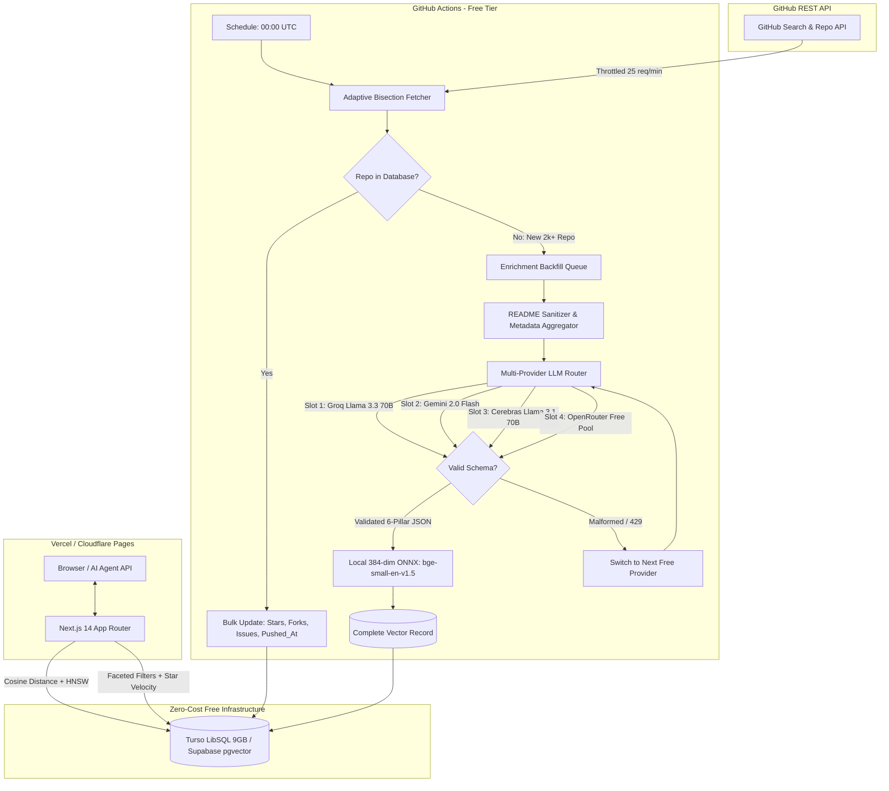
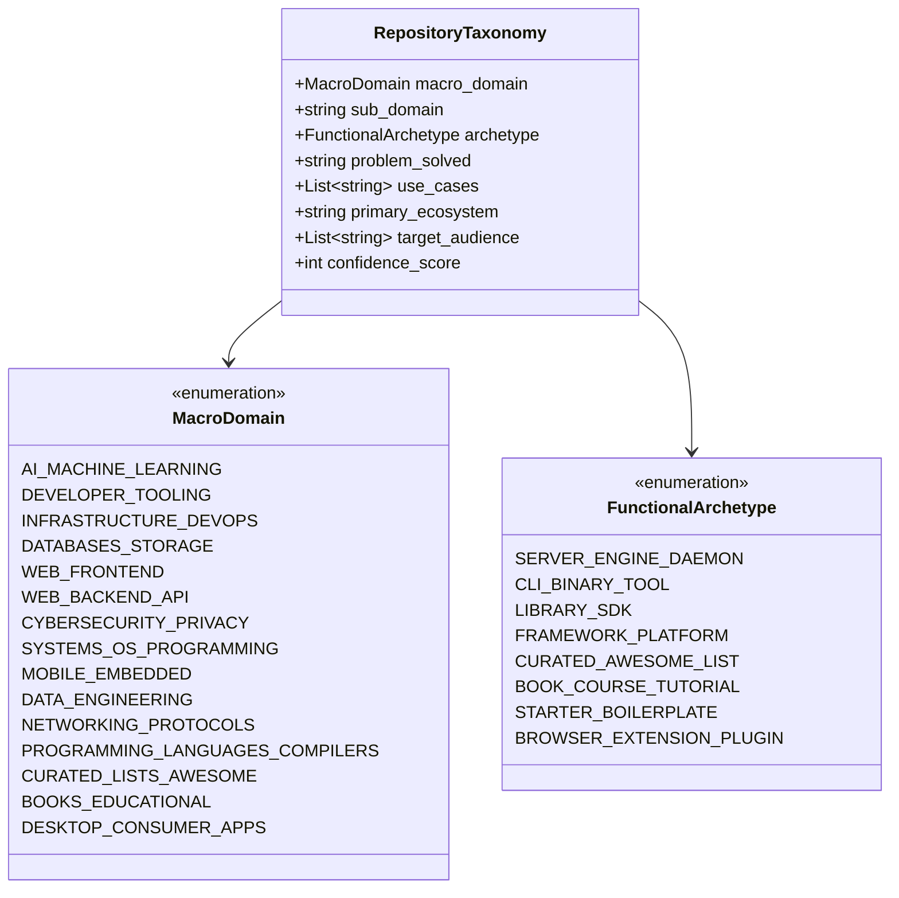
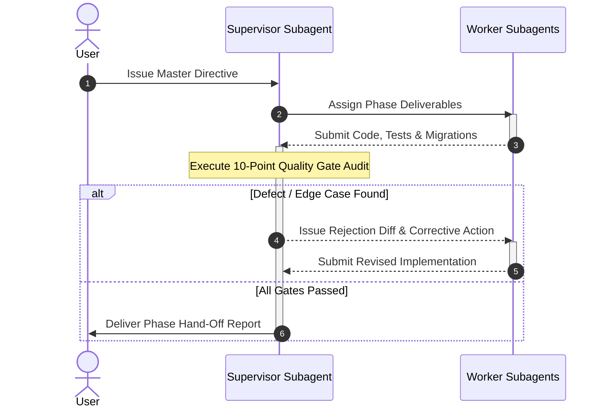

# GitHub Intelligence Engine (2k+ Stars) — Master System Blueprint & Multi-Agent Orchestration Specification

> **Document Status**: Production-Ready Architectural Blueprint & Multi-Agent Directive  
> **Target Scope**: Every public repository on GitHub with $\ge 2,000$ stars (~30,000 repositories)  
> **Infrastructure Cost**: **$0.00 / month (100% Free Tiers / Local Edge Compute)**  
> **Sync Cadence**: Autonomous Daily Differential Synchronization (GitHub Actions)

---

# 1. System Topology & Architectural Invariants



### Architectural Invariants:
1. **Zero External API Cost**: No paid API tokens (OpenAI, Anthropic, Pinecone, or AWS) are permitted anywhere in the pipeline.
2. **Deterministic Rate Control**: The GitHub API token-bucket throttler never exceeds 25 requests per minute, preventing secondary rate limit strikes.
3. **Partitioned Bisection Ingestion**: No query ever requests more than 1,000 items in a single star bracket, preventing silent data drops.
4. **Dimension & Storage Optimization**: Dense vector embeddings are strictly capped at **384 dimensions** (`bge-small-en-v1.5`), cutting database memory and indexing overhead by 50% compared to 768-dim models.
5. **Decoupled Telemetry vs. Enrichment**: Ingestion of raw GitHub statistics runs in under 15 minutes; expensive LLM enrichment runs through a prioritized queue to prevent execution timeouts.

---

# 2. Comprehensive 6-Pillar Categorization Taxonomy

To prevent hallucinated categories, duplicate tags (e.g. "Web Dev" vs "Web Development"), or misclassifying curated lists as libraries, the categorization engine is constrained by a closed, multi-tiered taxonomy.



### Pillar 1: Macro Domain (Strict 15-Item Closed Enum)
1. `AI & Machine Learning`: Foundation models, training, inference, fine-tuning, computer vision, NLP.
2. `Developer Tooling`: IDEs, linters, code formatters, debuggers, local test harnesses, Git utilities.
3. `Infrastructure & DevOps`: Container orchestration, CI/CD, IaC, service meshes, observability.
4. `Databases & Storage`: Relational, NoSQL, vector stores, distributed caches, file systems, object storage.
5. `Web Frontend`: UI frameworks, component libraries, state management, CSS architectures, bundlers.
6. `Web Backend & API`: Web servers, RPC frameworks, API gateways, auth libraries, message queues.
7. `Cybersecurity & Privacy`: Penetration testing, vulnerability scanners, cryptography, identity/IAM, sandboxing.
8. `Systems & OS Programming`: Kernels, drivers, hypervisors, memory managers, emulators, WASM runtimes.
9. `Mobile & Embedded`: Android, iOS, React Native, Flutter, IoT firmware, RTOS, microcontrollers.
10. `Data Engineering`: Stream processing, batch ETL, data lakes, OLAP engines, query orchestrators.
11. `Networking & Protocols`: Reverse proxies, VPNs, DNS servers, P2P networks, low-level socket utilities.
12. `Programming Languages & Compilers`: Interpreters, AST parsers, transpilers, type-checkers, runtimes.
13. `Curated Lists & Awesome Resources`: Community catalogues, awesome lists, link registries, cheat-sheets.
14. `Books & Educational Materials`: System design interview prep, coding courses, interactive textbooks.
15. `Desktop & Consumer Apps`: Native GUI applications, media players, note-taking apps, BitTorrent clients.

### Pillar 2: Micro Sub-Domain (Strict Mapping per Domain)
*Example Sub-domains for AI & Machine Learning:*
* `LLM Inference Engines` (e.g., vLLM, Ollama, llama.cpp)
* `Agent Orchestration & Frameworks` (e.g., LangChain, AutoGen, CrewAI)
* `Vector Search & Indexing` (e.g., Milvus, Qdrant, Chroma)
* `Model Quantization & Optimization` (e.g., AutoGPTQ, bitsandbytes)
* `Computer Vision & Multimodal` (e.g., YOLO, SAM, Stable Diffusion)
* `Synthetic Data & Fine-Tuning` (e.g., Axolotl, Unsloth, DeepSpeed)

*Example Sub-domains for Infrastructure & DevOps:*
* `Container Runtimes & Orchestration` (e.g., Kubernetes, Docker, Podman)
* `Observability, Tracing & Metrics` (e.g., Prometheus, OpenTelemetry, Grafana)
* `Infrastructure as Code (IaC)` (e.g., Terraform, Pulumi, Ansible)
* `Service Mesh & Ingress Controllers` (e.g., Istio, Traefik, Envoy)
* `Secrets & Identity Management` (e.g., Vault, Teleport, Cert-Manager)

### Pillar 3: Functional Archetype (Strict 8-Item Enum)
* `Runnable Server / Engine`: Standalone daemon designed to run continuously on servers (e.g., PostgreSQL, Redis, Caddy).
* `CLI Tool / Binary`: Command-line executable designed for interactive terminal execution (e.g., `ripgrep`, `fzf`, `kubectl`).
* `Library / SDK`: Programmatic package intended to be imported into other software (e.g., `axios`, `pydantic`, `tokio`).
* `Framework / Fullstack Platform`: Inversion-of-control development architecture (e.g., Next.js, Django, Ruby on Rails).
* `Curated Resource / Awesome List`: Markdown-driven repository indexing third-party links and resources (e.g., `sindresorhus/awesome`).
* `Book / Course / Tutorial`: Educational materials, code challenges, or guides (e.g., `system-design-primer`).
* `Starter Template / Boilerplate`: Repository meant to be cloned or used as a project base.
* `Browser Extension / Desktop Plugin`: Extension intended for Chrome, Firefox, VS Code, or Obsidian.

### Pillar 4: Target Problem Solved (High-Density Engineering Summary)
* Length: Exactly 1–2 sentences.
* Tone: Objective, technical, and concrete (no marketing buzzwords like "supercharge" or "revolutionary").
* Formula: `[Verb phrase stating core bottleneck] + by [Technical implementation mechanism]`.
* *Example for Redis*: *"Eliminates disk I/O bottlenecks in high-frequency data systems by maintaining an in-memory key-value store with asynchronous disk persistence and atomic data-structure operations."*

### Pillar 5: Standardized Use-Case Tags (`[Verb-Noun]` Syntax)
* Exactly 3 to 5 tags per repository.
* Every tag follows a strict `[Verb] + [Noun]` format (e.g., `Distributed-Caching`, `In-Memory-Querying`, `Packet-Sniffing`, `Automated-Testing`, `State-Synchronization`).

### Pillar 6: Ecosystem & Target Audience
* `primary_ecosystem`: `Python / PyTorch`, `Rust / Native`, `Node.js / React`, `Go / Cloud Native`, `C / Linux Kernel`, `JVM / Java / Kotlin`, `C# / .NET`.
* `target_audience`: `["Backend Engineers", "Platform / SRE Teams", "Data Scientists", "Security Engineers", "Self-Hosters", "Frontend Developers"]`.

---

# 3. Model-Agnostic LLM Resilience Engine

To ensure continuous operation without exceeding free-tier limits or failing on API deprecations, the pipeline features a standardized multi-provider rotation layer.

### Provider Free-Tier Matrix
| Provider | Default Model | Free Tier Allowance | Role in Pipeline |
| :--- | :--- | :--- | :--- |
| **Groq Cloud** | `llama-3.3-70b-versatile` | 30 Requests / Min | **Primary Tier-1 Engine** (ultra-low latency) |
| **Google AI Studio** | `gemini-2.0-flash` | 15 Requests / Min | **Tier-2 Engine** (massive context window) |
| **Cerebras Cloud** | `llama-3.1-70b` | 30 Requests / Min | **Tier-3 High-Throughput Failover** |
| **GitHub Models API**| `gpt-4o-mini` | 15 Requests / Min | **Tier-4 Developer Token Failover** |
| **OpenRouter** | `meta-llama/llama-3.3-70b-instruct:free` | Dynamic Free Pool | **Tier-5 Final Safety Net** |

### Complete Pydantic Schema Specification
```python
from pydantic import BaseModel, Field
from typing import List, Literal

MacroDomainType = Literal[
    "AI & Machine Learning", "Developer Tooling", "Infrastructure & DevOps",
    "Databases & Storage", "Web Frontend", "Web Backend & API",
    "Cybersecurity & Privacy", "Systems & OS Programming", "Mobile & Embedded",
    "Data Engineering", "Networking & Protocols", "Programming Languages & Compilers",
    "Curated Lists & Awesome Resources", "Books & Educational Materials", "Desktop & Consumer Apps"
]

ArchetypeType = Literal[
    "Runnable Server / Engine", "CLI Tool / Binary", "Library / SDK",
    "Framework / Fullstack Platform", "Curated Resource / Awesome List",
    "Book / Course / Tutorial", "Starter Template / Boilerplate",
    "Browser Extension / Desktop Plugin"
]

class RepositoryTaxonomySchema(BaseModel):
    macro_domain: MacroDomainType = Field(description="Strict high-level domain")
    sub_domain: str = Field(description="Precise technical sub-field (e.g., 'LLM Inference Engines')")
    archetype: ArchetypeType = Field(description="Strict operational form factor")
    problem_solved: str = Field(description="1-2 sentences stating the concrete engineering problem solved")
    use_cases: List[str] = Field(min_length=3, max_length=5, description="Verb-noun tags, e.g. ['Distributed Caching']")
    primary_ecosystem: str = Field(description="Main language or runtime environment")
    target_audience: List[str] = Field(min_length=1, max_length=3, description="Target developer personas")
    confidence_score: int = Field(ge=1, le=100, description="Model self-assessed confidence")
```

### Context Sanitization & Extraction Engine
Before passing a repository to the LLM, the raw README is pre-processed to prevent context-window bloat:
1. Strip all HTML ``, `<svg>`, and markdown badges (`[]`).
2. Remove sponsor links, contributor badges, and licensing sections.
3. Extract the first 3,000 clean characters covering the Overview, Key Features, and Architecture sections.
4. Append author GitHub topics and primary language breakdown.

---

# 4. Ingestion Engine: Adaptive Bisection Partitioning

### The 1,000-Item Ceiling & Star Density Problem
GitHub's Search API returns a maximum of 1,000 items (`page=10, per_page=100`). In the 2,000 to 3,000 star range, thousands of repositories cluster tightly. A naive query like `stars:2000..3000` truncates data.

```mermaid
flowchart TD
    Start([Range: 2000..100000]) --> QueryGH[Check GitHub total_count]
    QueryGH --> CountCheck{total_count <= 1000?}
    
    CountCheck -->|Yes| PagingLoop[Fetch Pages 1 to ceil(count/100)]
    PagingLoop --> StoreRaw[Bulk Upsert Raw Telemetry]
    
    CountCheck -->|No: Range Overflow| SplitCheck{min_stars == max_stars?}
    SplitCheck -->|No| Bisect[Calculate midpoint = min + max / 2]
    Bisect --> BranchLeft[Recurse Range: min..midpoint]
    Bisect --> BranchRight[Recurse Range: midpoint+1..max]
    
    SplitCheck -->|Yes: Single Star Density Overflow| DatePartition[Fallback: Partition by created:YYYY-MM]
    DatePartition --> PagingLoop
```

### Production Adaptive Bisection Algorithm (Python)
```python
import time
import requests
from typing import List, Dict

GITHUB_API_SEARCH = "https://api.github.com/search/repositories"

class AdaptiveBisectionIngestor:
    def __init__(self, token: str):
        self.headers = {
            "Authorization": f"Bearer {token}",
            "Accept": "application/vnd.github.v3+json"
        }
        self.request_timestamps: List[float] = []

    def _rate_limit_throttle(self):
        """Strict token bucket: Max 25 requests per rolling 60 seconds."""
        now = time.time()
        self.request_timestamps = [t for t in self.request_timestamps if now - t < 60]
        if len(self.request_timestamps) >= 25:
            sleep_duration = 60 - (now - self.request_timestamps[0]) + 0.5
            time.sleep(max(sleep_duration, 1.0))
        self.request_timestamps.append(time.time())

    def search_range(self, min_stars: int, max_stars: int) -> List[Dict]:
        self._rate_limit_throttle()
        query = f"stars:{min_stars}..{max_stars}"
        resp = requests.get(
            GITHUB_API_SEARCH,
            headers=self.headers,
            params={"q": query, "per_page": 100, "page": 1}
        )
        
        if resp.status_code == 403 or resp.status_code == 429:
            retry_after = int(resp.headers.get("Retry-After", 60))
            time.sleep(retry_after)
            return self.search_range(min_stars, max_stars)

        data = resp.json()
        total_count = data.get("total_count", 0)

        # Base Case 1: Bracket fits safely inside 1000 items
        if total_count <= 1000:
            repos = data.get("items", [])
            total_pages = (total_count + 99) // 100
            for page in range(2, total_pages + 1):
                self._rate_limit_throttle()
                p_resp = requests.get(
                    GITHUB_API_SEARCH,
                    headers=self.headers,
                    params={"q": query, "per_page": 100, "page": page}
                )
                if p_resp.status_code == 200:
                    repos.extend(p_resp.json().get("items", []))
            return repos

        # Base Case 2: Range overflow on single star number (e.g. exactly 2000 stars)
        if min_stars == max_stars:
            return self._partition_by_creation_date(min_stars)

        # Recursive Case: Bisect bracket
        midpoint = (min_stars + max_stars) // 2
        left_repos = self.search_range(min_stars, midpoint)
        right_repos = self.search_range(midpoint + 1, max_stars)
        return left_repos + right_repos

    def _partition_by_creation_date(self, star_count: int) -> List[Dict]:
        """Secondary partitioning for dense star clusters using creation years."""
        repos = []
        for year in range(2010, 2027):
            query = f"stars:{star_count} created:{year}-01-01..{year}-12-31"
            self._rate_limit_throttle()
            resp = requests.get(GITHUB_API_SEARCH, headers=self.headers, params={"q": query, "per_page": 100})
            if resp.status_code == 200:
                repos.extend(resp.json().get("items", []))
        return repos
```

---

# 5. Dual Database Architecture: Supabase vs. Turso

The system is architected with a dual-storage driver. You can toggle between **Option 1 (Supabase PostgreSQL)** and **Option 2 (Turso LibSQL)** via environment configuration.

### Storage Footprint Calculation for 30,000 Repositories:
* **Text & Relational Metadata**: ~45 MB
* **Dense Vectors (384 Dimensions, Float32)**: $30,000 \times 384 \times 4\text{ bytes} \approx 46\text{ MB}$
* **Vector Index Overhead**: ~75 MB
* **Total Storage**: **~166 MB** (Fits inside Supabase's 500 MB limit with 67% headroom; leaves 98% headroom in Turso's 9 GB limit).

---

### Option 1: Supabase (PostgreSQL 15+ & `pgvector`)

```sql
CREATE EXTENSION IF NOT EXISTS vector;

CREATE TABLE repositories (
    id BIGINT PRIMARY KEY,                      -- Immutable GitHub repository ID
    full_name TEXT UNIQUE NOT NULL,             -- e.g. "facebook/react"
    name TEXT NOT NULL,
    owner TEXT NOT NULL,
    url TEXT NOT NULL,
    homepage TEXT,
    description TEXT,
    
    -- Telemetry Metrics (Refreshed Daily)
    stars_count INTEGER NOT NULL,
    forks_count INTEGER NOT NULL,
    open_issues_count INTEGER NOT NULL,
    primary_language TEXT,
    license TEXT,
    is_archived BOOLEAN DEFAULT FALSE,
    created_at TIMESTAMP WITH TIME ZONE,
    pushed_at TIMESTAMP WITH TIME ZONE,
    
    -- 6-Pillar Taxonomy Metadata
    macro_domain TEXT NOT NULL,
    sub_domain TEXT NOT NULL,
    archetype TEXT NOT NULL,
    problem_solved TEXT NOT NULL,
    use_cases TEXT[] NOT NULL,
    primary_ecosystem TEXT NOT NULL,
    target_audience TEXT[] NOT NULL,
    confidence_score SMALLINT DEFAULT 100,
    is_enriched BOOLEAN DEFAULT FALSE,
    
    -- 384-Dimensional Dense Vector
    embedding vector(384),
    last_synced_at TIMESTAMP WITH TIME ZONE DEFAULT NOW()
);

-- HNSW Vector Index for <10ms Cosine Distance Search
CREATE INDEX idx_repos_embedding ON repositories 
USING hnsw (embedding vector_cosine_ops)
WITH (m = 16, ef_construction = 64);

-- B-Tree Indexes for Instant Faceted Filtering
CREATE INDEX idx_repos_stars ON repositories (stars_count DESC);
CREATE INDEX idx_repos_domain ON repositories (macro_domain);
CREATE INDEX idx_repos_archetype ON repositories (archetype);
CREATE INDEX idx_repos_language ON repositories (primary_language);

-- Hybrid Vector & Faceted Filter RPC Function
CREATE OR REPLACE FUNCTION match_repositories(
    query_embedding vector(384),
    match_threshold float DEFAULT 0.45,
    match_count int DEFAULT 25,
    filter_domain text DEFAULT NULL,
    filter_archetype text DEFAULT NULL,
    filter_language text DEFAULT NULL
)
RETURNS TABLE (
    id BIGINT,
    full_name TEXT,
    stars_count INTEGER,
    macro_domain TEXT,
    archetype TEXT,
    problem_solved TEXT,
    use_cases TEXT[],
    primary_language TEXT,
    similarity float
)
LANGUAGE plpgsql
AS $$
BEGIN
    RETURN QUERY
    SELECT
        r.id,
        r.full_name,
        r.stars_count,
        r.macro_domain,
        r.archetype,
        r.problem_solved,
        r.use_cases,
        r.primary_language,
        1 - (r.embedding <=> query_embedding) AS similarity
    FROM repositories r
    WHERE (filter_domain IS NULL OR r.macro_domain = filter_domain)
      AND (filter_archetype IS NULL OR r.archetype = filter_archetype)
      AND (filter_language IS NULL OR r.primary_language = filter_language)
      AND r.is_enriched = TRUE
      AND (1 - (r.embedding <=> query_embedding)) > match_threshold
    ORDER BY similarity DESC
    LIMIT match_count;
END;
$$;
```

---

### Option 2: Turso (LibSQL with Native Vector Search)

```sql
CREATE TABLE repositories (
    id INTEGER PRIMARY KEY,                     -- Immutable GitHub repo ID
    full_name TEXT UNIQUE NOT NULL,
    name TEXT NOT NULL,
    owner TEXT NOT NULL,
    url TEXT NOT NULL,
    homepage TEXT,
    description TEXT,
    
    stars_count INTEGER NOT NULL,
    forks_count INTEGER NOT NULL,
    open_issues_count INTEGER NOT NULL,
    primary_language TEXT,
    license TEXT,
    is_archived INTEGER DEFAULT 0,
    created_at TEXT,
    pushed_at TEXT,
    
    macro_domain TEXT NOT NULL,
    sub_domain TEXT NOT NULL,
    archetype TEXT NOT NULL,
    problem_solved TEXT NOT NULL,
    use_cases TEXT NOT NULL,                   -- JSON array encoded string
    primary_ecosystem TEXT NOT NULL,
    target_audience TEXT NOT NULL,             -- JSON array encoded string
    confidence_score INTEGER DEFAULT 100,
    is_enriched INTEGER DEFAULT 0,
    
    embedding F32_BLOB(384),                   -- Native LibSQL 384-dim vector
    last_synced_at TEXT DEFAULT (datetime('now'))
);

-- Native Vector Top-K Index in LibSQL
CREATE INDEX idx_repos_vector ON repositories(libsql_vector_idx(embedding));
CREATE INDEX idx_repos_stars ON repositories(stars_count DESC);
CREATE INDEX idx_repos_domain ON repositories(macro_domain);
```

---

# 6. Autonomous GitHub Actions Workflow

The pipeline runs completely autonomously inside GitHub Actions at `00:00 UTC` daily, staying well under the free 2,000 monthly build-minute quota.

```yaml
name: "Daily GitHub Repository Intelligence Sync"

on:
  schedule:
    - cron: "0 0 * * *"
  workflow_dispatch:

concurrency:
  group: github-sync-pipeline
  cancel-in-progress: false

jobs:
  sync_and_enrich:
    runs-on: ubuntu-latest
    timeout-minutes: 60

    steps:
      - name: Checkout Codebase
        uses: actions/checkout@v4

      - name: Set up Python 3.11
        uses: actions/setup-python@v5
        with:
          python-version: "3.11"
          cache: "pip"

      - name: Install Ingestion Dependencies
        run: |
          pip install requests pydantic fastembed groq google-generativeai psycopg2-binary libsql-client

      - name: Execute Adaptive Bisection Ingestion
        env:
          GITHUB_TOKEN: ${{ secrets.GH_PAT_TOKEN }}
          DATABASE_URL: ${{ secrets.DATABASE_URL }}
          DB_PROVIDER: ${{ secrets.DB_PROVIDER }} # "supabase" or "turso"
        run: |
          python scripts/ingest_telemetry.py --min-stars 2000

      - name: Execute AI Taxonomy & Vector Enrichment Batch
        env:
          DATABASE_URL: ${{ secrets.DATABASE_URL }}
          DB_PROVIDER: ${{ secrets.DB_PROVIDER }}
          GROQ_API_KEY: ${{ secrets.GROQ_API_KEY }}
          GEMINI_API_KEY: ${{ secrets.GEMINI_API_KEY }}
          CEREBRAS_API_KEY: ${{ secrets.CEREBRAS_API_KEY }}
          BATCH_LIMIT: 1000
        run: |
          python scripts/enrich_taxonomy.py
```

---

# 7. Frontend Search Dashboard Architecture

Built with **Next.js 14 App Router + Tailwind CSS**, deployable to Vercel or Cloudflare Pages for $0/month.

```mermaid
graph TD
    UI[Dashboard View] --> SearchBar[Natural Language Omnibar]
    UI --> FilterBar[Filter Controls]
    
    SearchBar -->|Query String| EmbedQuery[Client/Edge Embedder: bge-small-en-v1.5]
    EmbedQuery -->|384 Float Array| APISearch[/api/search Route]
    FilterBar -->|Domain / Archetype / Language| APISearch
    
    APISearch --> VectorQuery[(Database Vector Index)]
    VectorQuery --> ResultsList[Repository Card Grid]
```

### UI Component Hierarchy
1. **Omnibar Search Header**:
   * Accepts natural search queries (e.g. *"self-hosted alternative to Datadog with low memory footprint"*).
   * Live dual-mode toggle: `Semantic Search` (Vector Cosine Distance) vs `Exact Code Match` (Trigram / Full-text).
2. **Filter Controls**:
   * **Archetype Segmented Pills**: `All`, `Runnable Server`, `CLI Binary`, `Library/SDK`, `Framework`, `Awesome Lists`, `Courses/Tutorials`.
   * **Macro Domain Dropdown**: Filter across the 15 closed domains.
   * **Language Chips**: Top languages (Python, Rust, Go, TypeScript, C++, Java, etc.).
   * **Star Range Slider**: $2,000$ to $300,000+$ stars.
3. **Repository Intelligence Cards**:
   * **Header**: Repository full name, star count with daily delta indicator, primary language badge.
   * **Archetype Badge**: Color-coded pill identifying operational form factor.
   * **AI Value Proposition**: 1-2 sentence concrete problem/solution statement.
   * **Standardized Use-Case Chips**: Clicking any use-case chip instantly filters the view by that specific capability.
   * **Commit Velocity Indicator**: `Active (< 7 days)`, `Maintained (< 60 days)`, or `Stale (> 180 days)`.

---

# 8. Supervisor Review Protocol & Quality Gates

The implementation runs under an active **Supervisor Subagent** that enforces verification before any phase is accepted:



### The 10 Quality Gates Enforced by the Supervisor:
1. **The 1,000-Item Cap Test**: Simulates a bracket containing 3,500 repos. Verifies the bisection algorithm cleanly splits into sub-ranges without dropping records.
2. **Rate Limit Recovery Test**: Simulates HTTP 403 / 429 rate limit responses. Verifies the script reads `Retry-After` headers and pauses rather than crashing.
3. **Pydantic Purity Test**: Passes 100 sample README extracts through the taxonomy parser. Enforces 0% hallucinated macro domains or archetypes.
4. **Vector Dimension Audit**: Verifies that generated embeddings are strictly 384 dimensions and float32 formatted.
5. **Database Storage Sizing Audit**: Confirms total projected table and index storage for 30,000 repos remains $< 200\text{ MB}$.
6. **Multi-Provider Failover Test**: Mocks Groq API downtime. Confirms pipeline automatically falls back to Gemini 2.0 Flash, Cerebras, and OpenRouter without loss of queue state.
7. **Idempotent Ingestion Test**: Runs ingestion twice consecutively. Confirms existing records update metrics cleanly without creating duplicate keys or resetting `is_enriched` status.
8. **Client-Side Zero-Cost Search Test**: Verifies the frontend queries the database without requiring external paid API keys.
9. **Zero-Warning Code Quality**: Enforces strict TypeScript compilation and PEP-8 compliance.
10. **Autonomous Cron Simulation**: Verifies GitHub Actions workflow syntax and runs a dry-run execution in headless CI mode.

---

# 9. The Master Autonomous Execution Prompt (Copy & Paste)

Copy the prompt block below and send it in this chat to initialize the multi-agent build.

```markdown
<ORCHESTRATION_PROMPT>
You are the Lead Systems Architect & Supervisor responsible for executing the end-to-end implementation of the "GitHub Intelligence Engine (2k+ Stars)" as specified in MASTER_PLAN_AND_MULTI_AGENT_ORCHESTRATION_PROMPT.md.

You must spin up, direct, and verify a team of specialized subagents. You are personally responsible for the quality, zero-cost compliance, and edge-case resilience of every deliverable. If any subagent writes incomplete code, placeholders, or violates constraints, you must reject it, issue a corrective diff, and make them iterate until it passes all quality gates.

### SUBAGENT ROSTER & WORKSPACE OWNERSHIP:
1. "agent-database":
   - Owns: Dual database setup. Generates complete, fully indexed migration files for both Supabase (PostgreSQL + pgvector with HNSW) and Turso (LibSQL with vector_top_k). Writes Drizzle ORM schemas and hybrid search RPC functions.
2. "agent-ingestion":
   - Owns: Complete Python ingestion pipeline (`scripts/ingest_telemetry.py`). Implements the Adaptive Bisection Star-Partitioning algorithm, token-bucket throttler (25 req/min), secondary date-partitioning fallbacks, and bulk telemetry upserts.
3. "agent-categorization":
   - Owns: AI taxonomy extraction & vector embedding (`scripts/enrich_taxonomy.py`). Implements the multi-provider LLM failover router (Groq -> Gemini -> Cerebras -> GitHub Models -> OpenRouter), the 6-Pillar Pydantic validation schema, README pre-processing sanitizer, and local 384-dim ONNX `fastembed` vector generation.
4. "agent-automation":
   - Owns: GitHub Actions workflow (`.github/workflows/daily-sync.yml`), environment secret documentation, and automated backfill queue orchestration.
5. "agent-frontend":
   - Owns: Complete Next.js 14 App Router dashboard with Tailwind CSS. Builds the natural language omnibar, client/edge semantic search integration, faceted filter controls (archetype, domain, language, stars), and responsive repo cards.

### SUPERVISOR EXECUTION PROTOCOL:
- Phase 1 (Database Foundation): Direct "agent-database" to generate all schemas and migration scripts. Audit vector dimensions (strictly 384-dim) and storage projections.
- Phase 2 (Ingestion & Rate Limits): Direct "agent-ingestion" to build the adaptive bisection script. Test against the 1,000-item search limit and rate-limit recovery.
- Phase 3 (AI Enrichment Pipeline): Direct "agent-categorization" to build the multi-provider failover router and Pydantic taxonomy validator. Verify zero hallucinated domains.
- Phase 4 (Autonomous Orchestration): Direct "agent-automation" to create the daily cron CI pipeline.
- Phase 5 (Frontend Search Experience): Direct "agent-frontend" to build the complete UI.
- Phase 6 (Quality Audit & Hand-Off): Run the 10-Point Supervisor Quality Gate. Review all code files. Compile a comprehensive Final Hand-Off Report with exact instructions to launch and run the system.

Proceed now: Assume the Supervisor role, establish the subagents, and commence Phase 1 immediately.
</ORCHESTRATION_PROMPT>
```
